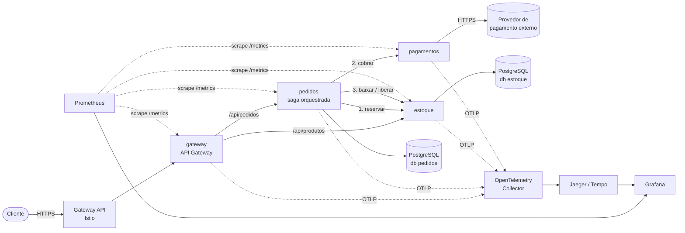

# Pedidos Veloz — entrega contínua de microsserviços (Compose → Kubernetes)

[](https://github.com/rodrigonevesofi/loja-veloz/actions/workflows/pipeline.yml)

**Autor:** Rodrigo Neves Vieira · ADS 5° NA · Cloud DevOps — Projeto de Entrega Contínua

Plataforma de pedidos da **Loja Veloz** modernizada de ponta a ponta: desenvolvimento local
padronizado com Docker Compose, imagens enxutas e versionadas, Kubernetes com práticas de produção,
pipeline CI/CD com gates de qualidade e segurança, canary deploy, autoscaling e observabilidade
completa (métricas, logs e tracing distribuído com OpenTelemetry).

> 🎬 **Vídeo pitch:** <https://youtu.be/SEU-LINK-AQUI> *(substitua pelo link do YouTube)*
> 📄 **Relatórios:** [docs/relatorio-teorico.pdf](docs/relatorio-teorico.pdf) · [docs/relatorio-pratico.pdf](docs/relatorio-pratico.pdf)
> 🗒️ **Roteiro do vídeo:** [docs/roteiro-video.md](docs/roteiro-video.md)

---

## 1. Arquitetura



| Serviço | Responsabilidade | Dados |
|---|---|---|
| `gateway` | Entrada única HTTP, roteamento `/api/*`, timeouts, `X-Request-ID`, allowlist de headers | — |
| `pedidos` | Cria/consulta pedidos; **saga orquestrada** (reserva → pagamento → baixa, com compensação); `Idempotency-Key` | banco `pedidos` |
| `estoque` | Catálogo, reserva com `SELECT … FOR UPDATE` (sem overselling), baixa e liberação idempotentes | banco `estoque` |
| `pagamentos` | Adaptador **stateless** do provedor externo (latência, falhas e recusas simuladas e configuráveis) | — |
| `libs/veloz_common` | *Microservice chassis*: logs JSON com `trace_id`, métricas RED, OpenTelemetry, `/health/live`, `/health/ready` | — |

**Mensageria:** não incluída no MVP, por decisão. O fluxo de pedido precisa de resposta síncrona
(o cliente quer saber na hora se o pedido foi aprovado), e um broker adicionaria mais um componente
stateful para operar em 4 semanas. A consistência entre serviços é garantida pela saga com ações
compensatórias idempotentes. O próximo passo previsto é publicar `PedidoCriado`/`PedidoConfirmado`
com **outbox pattern** (tabela de outbox + relay para SNS/SQS ou Kafka), para os consumidores
assíncronos (e-mail, analytics, antifraude).

### Estados de um pedido

```
PENDENTE ──reserva ok──► pagamento ──aprovado──► baixa ──► CONFIRMADO
   │                         │
   │                         ├─recusado──► liberar reserva ──► PAGAMENTO_RECUSADO
   │                         └─indisponível► liberar reserva ──► FALHA
   └─estoque insuficiente / SKU inexistente ──► REJEITADO
```

## 2. Estrutura do repositório

```
services/<svc>/            código (app/), testes (tests/), Dockerfile multi-stage, requirements.txt fixado
libs/veloz_common/         chassis compartilhado (observabilidade + health checks)
docker-compose.yml         ambiente local completo (app + Postgres + OTel Collector + Jaeger + Prometheus + Grafana)
observability/             configs do Collector, Prometheus (scrape + alertas SLO) e Grafana (datasources + dashboard)
deploy/k8s/base/           Deployments, Services, HPA, PDB, NetworkPolicies, ConfigMap, Namespace com PSA restricted
deploy/k8s/components/     istio (mTLS, AuthorizationPolicy, retries, circuit breaker, HTTPRoute), canary-pedidos,
                           monitoring (ServiceMonitor + PrometheusRule), vpa
deploy/k8s/overlays/       local (kind) · staging · prod
deploy/k8s/platform/       recursos do cluster (Gateway, ClusterSecretStore, namespaces) + values Helm
infra/terraform/           módulo `platform` (VPC, EKS, RDS, Secrets Manager, IAM/OIDC) + raízes envs/staging e envs/prod
.github/workflows/         pipeline.yml (CI/CD) e deploy.yml (deploy reutilizável)
scripts/                   smoke_test.py, canary.sh, load/pico-campanha.js (k6)
docs/                      relatórios PDF, roteiro do vídeo e gerador dos PDFs
```

## 3. Rodando localmente (um único comando)

Pré-requisito: Docker Desktop (ou Docker Engine) com Compose v2.20+.

```bash
docker compose up -d --build --wait
```

Pronto: 9 contêineres sobem já com healthcheck, na ordem certa (`depends_on: service_healthy`).

| O quê | Onde |
|---|---|
| API (gateway) | <http://localhost:8080/api/produtos> |
| OpenAPI do gateway | <http://localhost:8080/docs> (os serviços internos não são expostos ao host, de propósito) |
| Traces (Jaeger) | <http://localhost:16686> |
| Métricas (Prometheus) | <http://localhost:9090> |
| Dashboards (Grafana) | <http://localhost:3000> → pasta **Loja Veloz** (acesso anônimo de leitura; admin/`admin-dev`) |

Teste rápido (bash):

```bash
curl -s localhost:8080/api/produtos
curl -s -X POST localhost:8080/api/pedidos \
  -H 'Content-Type: application/json' -H 'Idempotency-Key: pedido-123' \
  -d '{"cliente_id":"cli-1","itens":[{"sku":"SKU-001","quantidade":2}]}'
python3 scripts/smoke_test.py          # 5 verificações ponta a ponta
```

No PowerShell:

```powershell
Invoke-RestMethod -Method Post http://localhost:8080/api/pedidos -ContentType 'application/json' -Headers @{ 'Idempotency-Key' = 'pedido-123' } -Body '{"cliente_id":"cli-1","itens":[{"sku":"SKU-001","quantidade":2}]}'
```

Outros comandos úteis: `make logs` (logs JSON), `make load` (k6 simulando a campanha),
`docker compose watch` (rebuild automático ao salvar), `make down` (derruba e limpa volumes).
Para sobrescrever credenciais e parâmetros: `cp .env.example .env`.

**Para demonstrar falhas:** `PAYMENT_PROVIDER_FAILURE_RATE=0.3 docker compose up -d pagamentos` faz 30% das
autorizações falharem; os pedidos terminam em `FALHA` com a reserva compensada, o alerta
`ProvedorDePagamentoInstavel` dispara no Prometheus e o trace mostra o span `saga.compensar`.

### Testes e lint (sem Docker)

```bash
pip install -r services/pedidos/requirements.txt ./libs/veloz_common pytest ruff
make test     # 33 testes: chassis + 4 serviços
make lint
```

## 4. Contêineres e versionamento

- **Multi-stage**: o estágio `builder` instala dependências num virtualenv; o `runtime` copia só o venv e o código
  (sem pip, compiladores ou cache). Base `python:3.13-slim-bookworm`.
- **Segurança**: usuário não-root com UID fixo `10001` (o mesmo do `runAsUser` no Kubernetes), `pip` removido da
  imagem final, `PYTHONDONTWRITEBYTECODE` (compatível com `readOnlyRootFilesystem`), `HEALTHCHECK`, `CMD` em forma
  exec (o uvicorn é PID 1 e recebe o `SIGTERM` para shutdown gracioso). Dependências com versão exata.
- **Cache de build**: `requirements.txt` é copiado antes do código, e `--mount=type=cache` guarda o cache do pip fora da imagem.
- **Tags imutáveis**: `sha-<commit>` em todo push; `X.Y.Z` e `X.Y` em releases (`vX.Y.Z`). Não usamos `:latest`.
  Os metadados OCI (`org.opencontainers.image.revision/version`) ligam a imagem ao commit.
- **Registry**: GitHub Container Registry (`ghcr.io/<owner>/loja-veloz-<serviço>`), com SBOM e proveniência SLSA anexados pelo BuildKit.

## 5. Kubernetes

```bash
# validar/renderizar
kubectl kustomize deploy/k8s/overlays/prod

# cluster local com kind
kind create cluster --name loja-veloz
make images && make kind-load
kubectl apply -k deploy/k8s/overlays/local
kubectl -n loja-veloz port-forward svc/gateway 8080:8000
```

- **Deployments + Services** (ClusterIP) por serviço, `ServiceAccount` própria sem token montado.
- **Probes**: `startupProbe` (protege o boot), `readinessProbe` em `/health/ready` (checa o banco: tira o pod do
  balanceamento) e `livenessProbe` em `/health/live` (só o processo; nunca dependências, para evitar reinício em cascata).
  `preStop: sleep 5s` + `terminationGracePeriodSeconds: 30` = zero requisições perdidas no deploy.
- **ConfigMap** gerado pelo Kustomize com hash no nome (mudou config → rolling update automático).
- **Secrets**: no overlay local, `secretGenerator` com valores de dev; em staging/prod, **External Secrets Operator**
  lê o AWS Secrets Manager (segredos criados pelo Terraform). Nenhuma credencial real no Git.
- **Segurança**:
  - namespace com **Pod Security Admission `restricted`** (enforce + audit + warn). Pods com root, privilege escalation,
    capabilities ou sem seccomp são rejeitados na admissão;
  - `securityContext`: `runAsNonRoot`, `readOnlyRootFilesystem`, `drop: [ALL]`, `seccompProfile: RuntimeDefault`;
  - **NetworkPolicies** *default deny* com allowlist por fluxo (o VPC CNI do EKS aplica as políticas; habilitado no Terraform);
  - **Istio**: mTLS `STRICT` + `AuthorizationPolicy` por identidade (só `pedidos` chama `pagamentos`). Instalado com
    **Istio CNI** para manter o PSA `restricted` (sem o init container privilegiado);
  - `ResourceQuota`/`LimitRange` no namespace; `PodDisruptionBudget` por serviço; espalhamento por zona.
- **Entrada**: Gateway API (`HTTPRoute`), sucessora do Ingress. O projeto ingress-nginx foi aposentado, por isso não o usamos.

## 6. Estratégia de deploy

| Onde | Estratégia | Por quê |
|---|---|---|
| Todos os serviços | **Rolling update** `maxSurge 25%`, `maxUnavailable 0`, `minReadySeconds 5` | Nativo, zero downtime, sem custo de infraestrutura duplicada. O rollout só avança com o pod *ready*. |
| `pedidos` em produção | **Canary** via Istio (`VirtualService` 5% → 10% → 25%) com gate automático no Prometheus (taxa de 5xx ≤ 1% e p95 ≤ 800 ms) | É o serviço que mexe com dinheiro e estoque: o raio de impacto de um bug fica limitado a uma fração do tráfego, e o rollback é só voltar o peso a 0% (segundos, sem redeploy). |

Blue/green foi descartado: dobra a capacidade durante a janela e não reduz o raio de impacto em relação ao canary.
Rollback automático: `progressDeadlineSeconds` + `kubectl rollout undo` no CD, e `scripts/canary.sh` volta o peso a 0%
se um gate falhar. Evolução natural: **Argo Rollouts** ou **Flagger** fazem esse ciclo de forma declarativa.

## 7. Escalabilidade

- **HPA (autoscaling/v2)** em todos os serviços stateless, CPU como sinal (alvo de 65–70%), `scaleUp` agressivo
  (+100% ou +4 pods a cada 15 s, sem janela de estabilização) e `scaleDown` conservador (janela de 5 min, −20%/min),
  para não oscilar no fim do pico.
- **Limites por serviço**: `pedidos` 4–30 em produção; `estoque` até 10 (o teto é o pool de conexões do PostgreSQL);
  `pagamentos` até 6, de propósito, para respeitar o rate limit do provedor externo.
- **VPA em modo `Off`** (só recomendação): HPA e VPA atuando sobre CPU entram em conflito; o VPA serve para
  calibrar `requests` a partir do consumo real.
- **Nós**: node group gerenciado com min/max no Terraform. Para produção, recomenda-se Karpenter ou Cluster Autoscaler,
  para que os pods criados pelo HPA tenham onde rodar.
- Carga de validação: `scripts/load/pico-campanha.js` (k6, até 150 req/s com thresholds iguais aos SLOs).

## 8. CI/CD (GitHub Actions)

```
PR:        lint ─┬─ testes (matriz 5) ─┬─ e2e (docker compose + smoke) ─┐
                 ├─ manifests (kustomize+kubeconform+trivy config) ─────┼─► build + scan Trivy (sem push)
                 └─ terraform (fmt+validate) ───────────────────────────┘
main:      ...tudo acima ─► push GHCR (sha-xxxxxxx, SBOM, proveniência) ─► deploy STAGING ─► smoke
tag vX.Y.Z ...tudo acima ─► STAGING ─► aprovação manual (Environment "production") ─► PRODUÇÃO + canary
```

**Gates**: ruff (lint + formatação + regras de segurança `S`), hadolint, shellcheck, `docker compose config`,
pytest com relatório JUnit, validação de schema dos manifests renderizados, scan de misconfiguração e de
vulnerabilidades (falha em CRITICAL/HIGH com correção disponível), `terraform validate`, E2E e smoke pós-deploy.

**Secrets no pipeline**:
- push no GHCR com o `GITHUB_TOKEN` efêmero (permissão `packages: write` só no job de build);
- deploy na AWS via **OIDC**: o job troca o token do GitHub por uma role IAM temporária, restrita a
  `repo:<owner>/<repo>:environment:<env>`. Não existe access key guardada;
- configuração não sensível em *Environment variables*: `AWS_REGION`, `AWS_DEPLOY_ROLE_ARN`, `EKS_CLUSTER_NAME`, `PUBLIC_URL`;
- `permissions: contents: read` por padrão e escalonado por job; Dependabot para pip, Docker, Actions e Terraform.
  O `trivy-action` (terceiro, roda com acesso às imagens) já está fixado pelo **SHA do commit**: tags podem ser reescritas ou removidas, como no incidente `tj-actions/changed-files` em 2025 (e a tag `0.28.0` do próprio trivy-action deixou de existir). Faça o mesmo com as demais Actions de terceiros.

**Configuração no GitHub**: o deploy fica desligado até existir a variável de repositório `AWS_DEPLOY_ROLE_ARN`. Para ligar, crie os Environments `staging` e `production` (este com *required reviewers*) e
preencha as variáveis acima com os outputs do Terraform.

## 9. Observabilidade

| Sinal | Como | Onde ver |
|---|---|---|
| **Métricas** | RED por serviço/rota (`http_requests_total`, `http_request_duration_seconds`, `http_requests_in_flight`) + negócio (`pedidos_total{status}`, `pedidos_receita_reais_total`, `pedidos_saga_duration_seconds`, `pagamentos_total{resultado}`, `estoque_reservas_total{resultado}`) + *spanmetrics* gerados no Collector | Prometheus / Grafana |
| **Logs** | JSON em stdout (12-Factor), uma linha por evento, com `trace_id`, `span_id`, `request_id`, `service` | `docker compose logs`; no K8s: Collector (filelog) → Loki |
| **Traces** | OpenTelemetry SDK + auto-instrumentação FastAPI/httpx/psycopg + spans de negócio (`saga.criar_pedido`, `saga.compensar`, `provedor.autorizar`); contexto W3C `traceparent` entre serviços | Jaeger (local) / Tempo (K8s) |

**Alertas por sintoma** (`observability/prometheus/alerts.yml`, os mesmos em `PrometheusRule`): serviço fora do ar,
5xx > 5%, p95 > 500 ms, instabilidade do provedor de pagamento e pedidos em `FALHA` acima de 2%.
**Amostragem**: 100% local; em produção os apps enviam tudo e o Collector faz *tail sampling*
(guarda 100% dos traces com erro ou lentos e 10% do restante).

## 10. Infraestrutura como código (Terraform)

```bash
cd infra/terraform/envs/staging
terraform init && terraform plan -out=tfplan && terraform apply tfplan
```

- Módulo `modules/platform`: VPC em 3 AZs (subnets privadas, públicas e de banco), **EKS** com add-ons
  (VPC CNI com NetworkPolicy, metrics-server, Pod Identity, EBS CSI), **RDS PostgreSQL** (Multi-AZ, criptografado,
  senha gerenciada no Secrets Manager), segredos por serviço, role OIDC do GitHub com *access entry* restrita ao
  namespace e role do External Secrets via Pod Identity.
- `envs/staging` e `envs/prod` chamam o mesmo módulo com parâmetros diferentes (paridade de ambientes) e têm
  **state separado** em S3, criptografado e com lock nativo (`use_lockfile`).
- Nível de esqueleto: estrutura e decisões estão prontas e validadas pelo `terraform validate` no CI. O bootstrap do
  bucket de state e a aplicação numa conta AWS real ficam para quem for operar.

## 11. Referência pesquisada (case público)

- **OpenTelemetry Demo — "Astronomy Shop"** (<https://github.com/open-telemetry/opentelemetry-demo>,
  <https://opentelemetry.io/docs/demo/>): e-commerce de referência da CNCF com mais de 10 microsserviços em várias
  linguagens, distribuído com **Docker Compose** (dev) e **Helm/Kubernetes**. Usa um OpenTelemetry Collector central
  exportando para Jaeger, Prometheus e Grafana, além de *feature flags* para injetar falhas. Daqui vieram o desenho de
  telemetria (SDK → Collector → backends trocáveis), a paridade Compose/Kubernetes e a ideia de falhas configuráveis
  (`PAYMENT_PROVIDER_FAILURE_RATE`).
- **Google Cloud — Online Boutique** (<https://github.com/GoogleCloudPlatform/microservices-demo>): loja de referência
  com 11 microsserviços, manifests Kubernetes, Kustomize *components* opcionais (Istio/service mesh, Network Policies,
  Cloud Operations) e Skaffold. Inspirou a organização do Kustomize em `base` + `components` + `overlays`.
- Documentação primária: Kubernetes (Deployments, Probes, HPA, Pod Security Admission, NetworkPolicy), Docker
  (multi-stage builds, Compose), 12factor.net, Terraform (módulos, backends S3), GitHub Actions (OIDC, Environments,
  reusable workflows), Istio (PeerAuthentication, traffic management, Istio CNI) e OpenTelemetry (SDK Python, Collector).

## 12. O que é funcional e o que é conceitual

| Funcional e testado | Pronto para uso, depende de infraestrutura externa |
|---|---|
| 4 serviços + chassis, 33 testes automatizados, E2E com Compose rodando no GitHub Actions | Deploy em EKS (exige conta AWS + `terraform apply`) |
| Ambiente Compose completo com observabilidade | Plataforma do cluster (Istio, kube-prometheus-stack, ESO; ver `deploy/k8s/platform/README.md`) |
| Manifests Kubernetes (overlay `local` roda em kind) | Canary com gate no Prometheus (script pronto; precisa do mesh no cluster) |
| Pipeline CI (lint, testes, scan, build, push GHCR) | CD para staging/produção (precisa dos Environments e da role OIDC) |

---
Licença MIT · Projeto acadêmico — Cloud DevOps.
